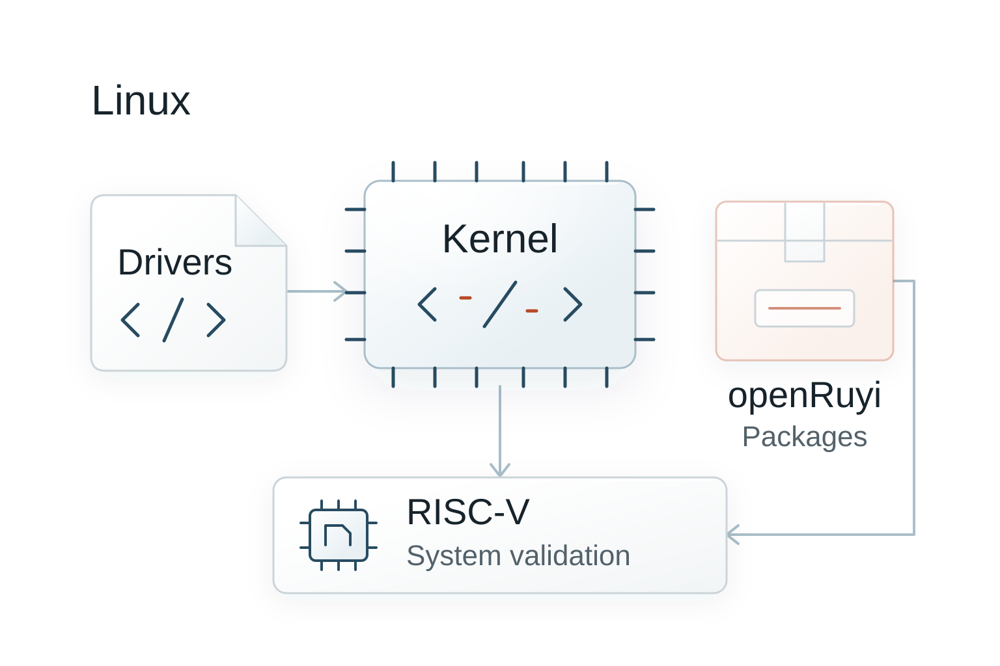
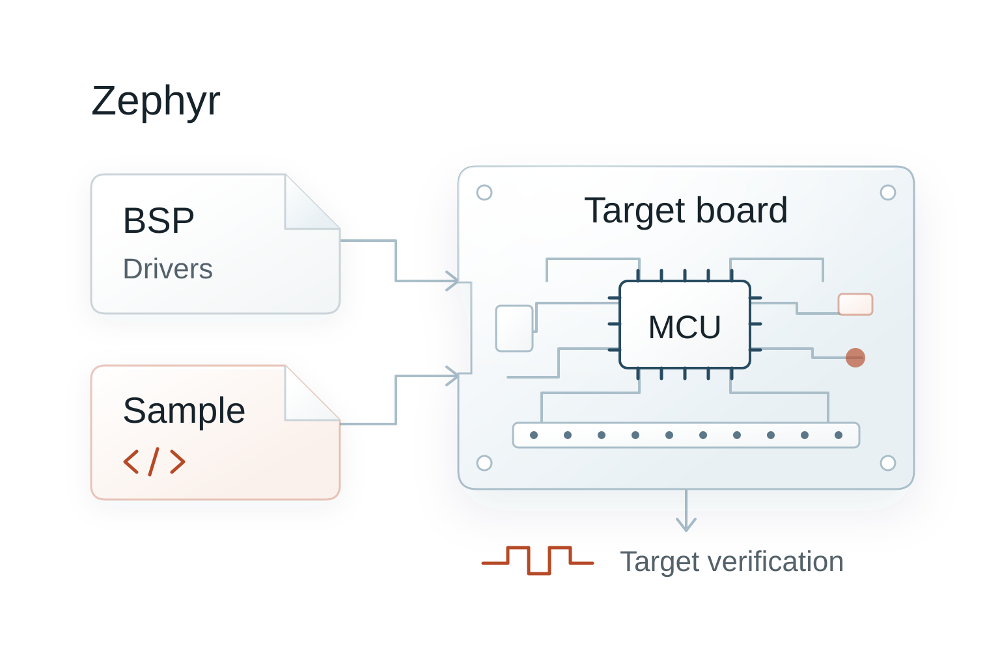
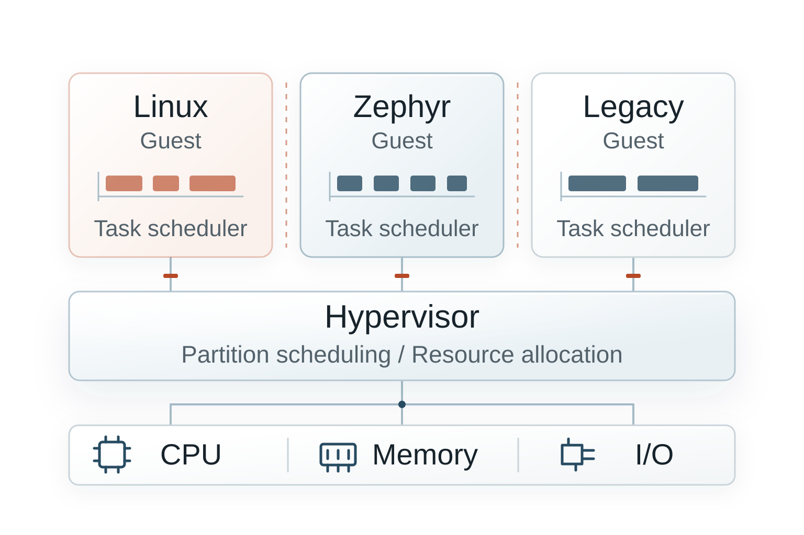

<section id="linux" class="detail-section" aria-labelledby="linux-title">

<h2 id="linux-title">Linux：复杂应用与软件生态</h2>

承载业务应用、AI 推理、网络与人机交互，按项目裁剪内核、驱动和用户态，选配 GPU / NPU 软件栈。

- 系统基线与应用配置分开维护，限定适配和验证范围。
- Hypervisor 隔离运行环境，独立 Monitor 监测故障；关键控制域保留自身的安全判定。
- 通过冗余启动、完整性校验、升级回退与恢复，保留异常处置路径。

裁剪、隔离与恢复须在目标硬件和配置上验证。认证范围及证据要求由具体项目定义，不代表 Linux 运行环境已获完整系统认证。

  <a class="text-link" href="../products/os/">行业操作系统</a>
  <a class="text-link" href="../products/devops/">构建与版本管理</a>
  <a class="text-link" href="../products/safety-assurance/">认证工程与安全论证</a>

</section>

<section id="zephyr" class="detail-section" aria-labelledby="zephyr-title">

<h2 id="zephyr-title">Zephyr：实时控制与现场通信</h2>

将强实时模块迁入 Zephyr，复杂业务保留在 Linux；两侧交换指令与状态，控制闭环在本地完成。

- 在调度、中断、同步与 IPC 路径采样，分析执行、等待与中断延迟。
- 配置优先级、核分配、时间预算及调度方案，结合 QEMU 与实机迭代。
- 复用 Devicetree、Kconfig 和 west 工程配置，通过 POSIX 及既有 RTOS 兼容接口减少源码迁移工作；两套系统分别构建。

迁移须核对所需接口和硬件行为。时序优化须评估采样开销，用实机校准仿真并验证约束，不能仅凭仿真承诺延迟。

  <a class="text-link" href="../products/os/">行业操作系统</a>
  <a class="text-link" href="../products/scheduling/">调度分析与优化</a>
  <a class="text-link" href="../products/devops/">双系统构建与验证</a>

</section>

<section id="hypervisor" class="detail-section" aria-labelledby="hypervisor-title">

<h2 id="hypervisor-title">Hypervisor：资源隔离与分区执行</h2>

分配核、内存、设备与中断，配置分区时间预算；Guest 各自调度内部任务，联合分析分区等待和 Guest 内部延迟。

- 配置中断路由、设备直通或虚拟设备，明确资源归属与隔离边界。
- 关联分区切换、虚拟中断和 Guest 事件，分析跨层时序。
- 以匹配的设备接口与启动环境承接存量系统；独立 Monitor 监测 Guest，由 Hypervisor 按策略启动、重启与恢复。

原镜像与驱动复用以指令架构兼容、虚拟硬件匹配为前提。内存、设备与中断隔离须结合目标 SoC、IOMMU 和分区配置验证。

  <a class="text-link" href="../products/hypervisor/">Hypervisor 产品</a>
  <a class="text-link" href="../products/scheduling/">分区与 Guest 联合优化</a>

</section>

Linux 与 Zephyr 插图依据 MFCP 项目说明重绘，参考图文遵循 <a href="../mfcp/LICENSE.txt">MIT 许可</a>；各图均为概念示意。

