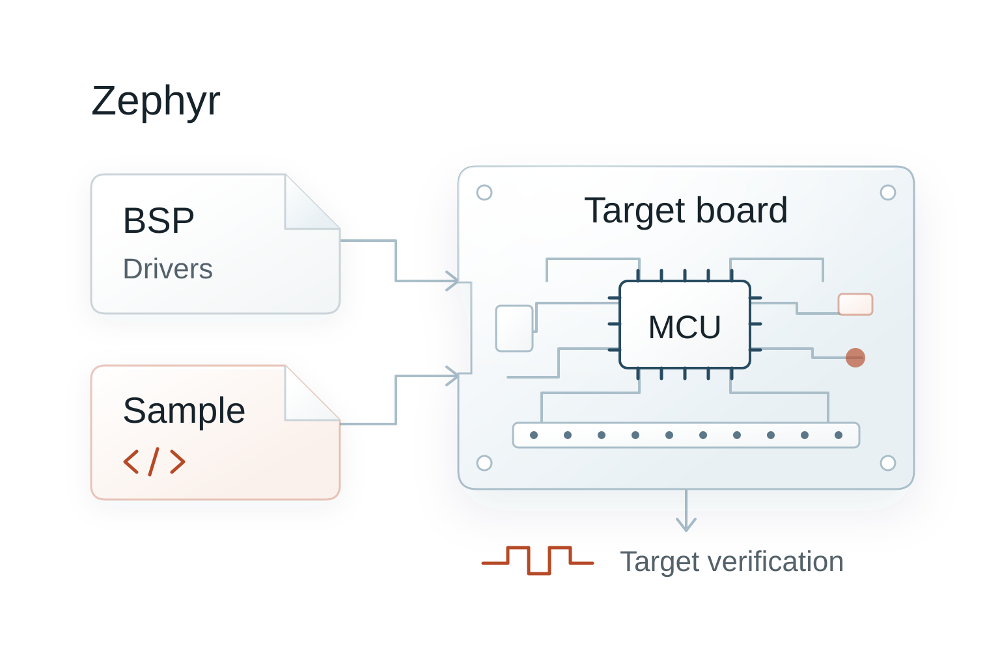
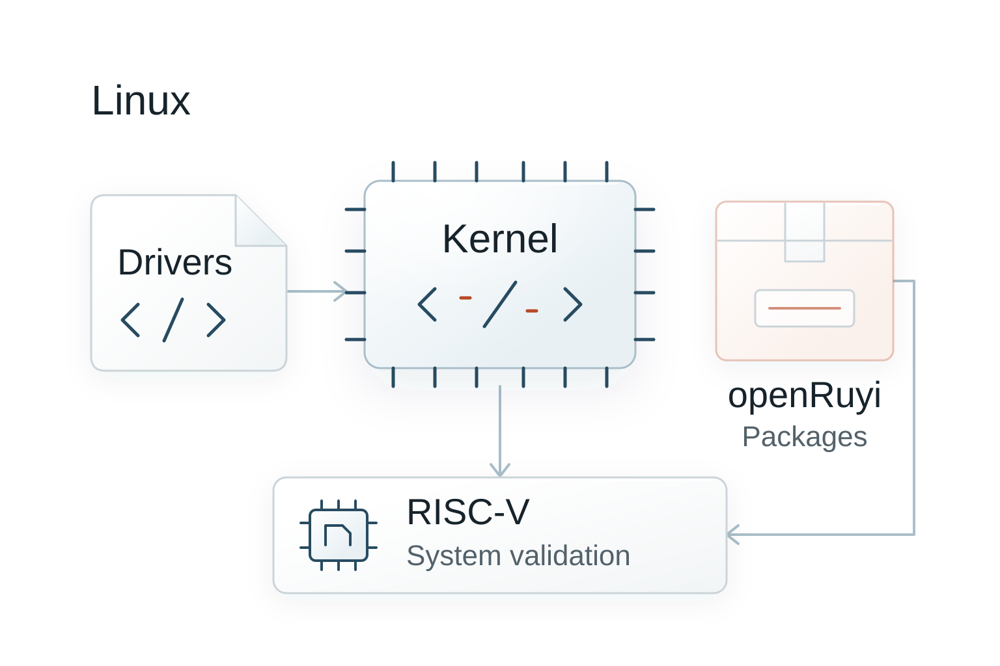
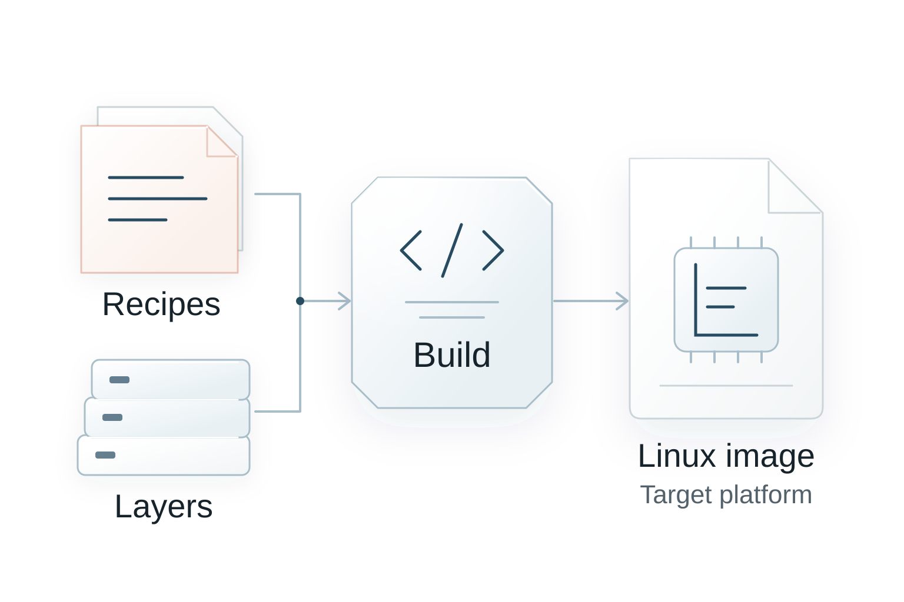
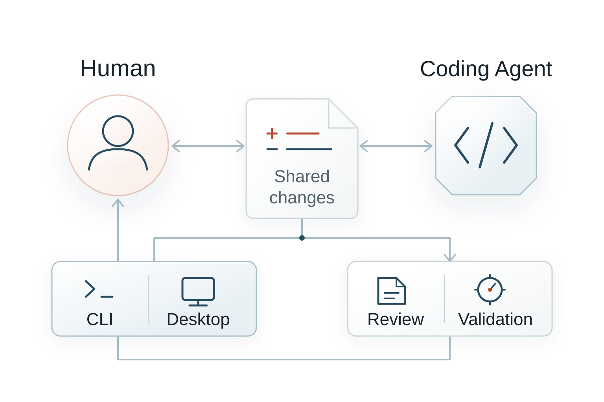

<section class="mfcp-directions">

## 四个实践方向

<article class="mfcp-project">

### [Zephyr](https://github.com/missionhub-oss/mfcp/blob/main/projects/zephyr/README.md)

探索板级支持、驱动与示例，在嵌入式平台上验证运行结果。

</article>
<article class="mfcp-project">

### [Linux](https://github.com/missionhub-oss/mfcp/blob/main/projects/linux/README.md)

参与内核与驱动开发，也可实践 openRuyi 软件包维护和 RISC-V 系统验证。

</article>
<article class="mfcp-project">

### [Yocto Project](https://github.com/missionhub-oss/mfcp/blob/main/projects/yocto/README.md)

编写配方、组织软件层，构建并验证目标平台的嵌入式 Linux 镜像。

</article>
<article class="mfcp-project">

### [Humanize](https://github.com/missionhub-oss/mfcp/blob/main/projects/humanize/README.md)

参与编程 Agent 协作工具开发，改进协作流程、命令行和桌面工具。

</article>

</section>

<section class="mfcp-process">

## 从注册到上游贡献

1. **注册审核** 提交注册 PR，经维护者审核合并后获得参与资格。
2. **选择方向** 阅读项目资料，选择感兴趣的实践方向。
3. **导师确认任务** 申请开放任务，由导师确认范围与目标。
4. **提交上游贡献** 记录验证结果，提交上游贡献并参与评审。

</section>

<section class="mfcp-entries">

## 官方入口

- [计划网站](https://missionhub-oss.github.io/mfcp/)
- [GitHub 仓库](https://github.com/missionhub-oss/mfcp)
- [参与指南与详细规则](https://github.com/missionhub-oss/mfcp/blob/main/docs/program.md)
- [飞书交流群](https://github.com/missionhub-oss/mfcp/blob/main/README.zh-CN.md#加入贡献者交流群)

2026 年招募公告尚未发布，具体安排以[年度培养安排](https://github.com/missionhub-oss/mfcp/blob/main/programs/2026/README.md)为准。

插图依据 MFCP 项目说明重绘，原始图文遵循 [MIT 许可](../../mfcp/LICENSE.txt)。

</section>
